# Network Traffic Analyser — pcap → Wireshark log → HDFS → Pig → Hive → Spark MLlib → Dashboard

CSE412 applied project, track **E (ETL + Warehouse + ML)**. An end-to-end pipeline over **74.9 million real packets
(10.8 GB of Wireshark-style packet logs)** captured on the router of a university network (CTU Prague), where lab
machines were deliberately infected with real botnet malware. It parses the packet logs into flows, warehouses
them, learns how infected hosts behave on the wire, flags them, and shows everything in a web dashboard.

**Question:** from packet headers alone, can we tell which machines on a network are infected, and does that
still work when the malware changes?

- **Demo video:** [`demo/demo.mp4`](demo/demo.mp4). Part 1 is the full pipeline run, with idle waits shortened and the real stage timings printed on screen. Part 2 is a dashboard walkthrough.
- **Dashboard:** `uv run streamlit run ui/app.py` → <http://localhost:8501>. It opens on **Analyse a capture**: upload a Wireshark capture and watch it go through the pipeline step by step. Screenshots are in [`demo/screens/`](demo/screens).

## Architecture

```mermaid
flowchart LR
  A[CTU-13 pcaps<br/>4 captures, 1.3 GB .bz2] -->|ingest/pcap_to_csv.py| B["Wireshark CSV<br/>No., Time, Source, Destination,<br/>Protocol, Length, Info"]
  B -->|streamed| C[(HDFS<br/>/netlogs/raw<br/>10.8 GB)]
  C --> D[Pig on Tez<br/>parse Info · reject non-IP<br/>dedupe · packets → 1-min flows]
  D -->|TSV| E[(HDFS<br/>/netlogs/pig/flows<br/>7.4M flows)]
  E --> F[Hive on Tez<br/>host labels · reverse-flow join<br/>host-minute features · reports]
  F -->|Parquet| G[(HDFS<br/>/netlogs/hive · /netlogs/dashboard)]
  G --> H[Spark MLlib<br/>LogReg · RandomForest<br/>2 evaluation protocols]
  H -->|Parquet| I[(HDFS<br/>/netlogs/spark)]
  I --> J[Hive: verdicts ·<br/>threat-hunt leads]
  J -->|export| K[Streamlit dashboard]
```



Every stage reads the previous stage's output from HDFS.

| Stage | Tool | Input → Output | Why this tool |
|---|---|---|---|
| Export | `ingest/pcap_to_csv.py` (stdlib) | pcapng → Wireshark CSV (`No., Time, Source, Destination, Protocol, Length, Info`) | The same columns as Wireshark's *Export Packet Dissections → CSV*. Reads pcap and pcapng (also .gz/.bz2) from Ethernet, Linux-cooked ("any" interface), raw-IP and loopback captures. `tshark` is the drop-in alternative; it needs root to install here. |
| Storage | HDFS 3.4.1 | 10.8 GB of packet logs, labels | Single store all three engines read and write. |
| ETL | Pig 0.18 on Tez | 74.9M packet rows → 7.4M flow records | Messy text: regexes over Wireshark's free-text `Info` column (`1038 → 6667 [SYN, ACK] … Len=0`), rejecting ARP/IPv6/malformed rows, `DISTINCT` de-duplication, and NetFlow-style aggregation with a 60 s active timeout. Dataflow scripting, not a natural SQL fit. |
| Warehouse | Hive 4.2 on Tez | flows + host labels → Parquet `host_windows` (2.3M host-minutes) + dashboard tables | Large joins: each flow joined to its **reverse flow** (did the other side ever answer?), the label join, per-host-minute aggregation, and SQL validation of Pig's cleaning. It also serves Spark's predictions back. |
| ML | Spark 4.0.2 MLlib | host-minutes → models, predictions | Distributed training and evaluation, run 10+ times across folds. |
| UI | Streamlit | exported Parquet → 5-page dashboard | Overview, traffic, Wireshark-style packet view, detection results, threat hunt. |

## Dataset

[CTU-13](https://www.stratosphereips.org/datasets-ctu13) (Garcia et al., *Computers & Security* 2014), from the Stratosphere Lab at CTU Prague. We use the four
captures whose header-truncated pcaps (54 B of each TCP packet, 42 B of UDP) are small enough to download overnight:

| Capture | CTU-13 scenario | Malware | Duration | Packets | Infected hosts |
|---|---|---|---|---|---|
| ctu46 | 5 | Virut (spam, port scan, HTTP) | 30 min | 4.5M | 147.32.84.165 |
| ctu52 | 11 | Rbot (IRC C&C, ICMP DDoS) | 16 min | 6.3M | .165, .191, .192 |
| ctu53 | 12 | NSIS.ay (P2P) | 1 h 13 min | 13.2M | .165, .191, .192 |
| ctu54 | 13 | Virut (spam, port scan, HTTP) | 16 h 22 min | 50.8M | .165 |

Labels come from each capture's README ([`labels/ctu13_hosts.csv`](labels/ctu13_hosts.csv)): the infected IPs, and three
verified **normal** workstations (.170, .134, .164). The dataset authors list the web, DNS and Matlab servers as unreliable,
so they are left unlabelled. All other traffic is **background**: real university users, unlabelled.

## What the pipeline found

Pig parsed **74,863,851 packet rows → 74,863,787 IPv4 packets** (64 rejected: ARP, IPv6, malformed). It found **0 exact
duplicates**: the de-duplication step ran but had nothing to remove in these captures. The packets became **7,394,677
one-minute flows**. Validation counts per capture are in [`results/hive_reports.txt`](results/hive_reports.txt).

How an infected host differs from a normal one, per minute (Hive, `d_label_profile`):

| per host-minute | infected | normal |
|---|---|---|
| TCP SYNs never answered | **26.1** | 0.002 |
| flows with no reply at all | 8.8 | 0.07 |
| SMTP flows (spam) | **6.6** | 0 |
| IRC flows (C&C, ports 6660–6669) | **1.0** | 0 |
| distinct destination IPs | 17.0 | 9.3 |

## Detection results

A sample is **one university host in one minute** with at least 5 packets. A minute with fewer packets carries no evidence:
an idle normal PC sending one keep-alive looks exactly like an idle bot. Positives are the infected hosts (1,186 minutes).
Negatives are the verified normal hosts (1,475) plus 84,201 background-host minutes. Treating the background as normal is
a *weak* label, since it may hide undiscovered infections, so **precision is a lower bound**. **Normal FPR** is the
false-alarm rate on the three verified-normal machines only.

**Protocol 1: known infection, later time.** Train on the first 70% of each capture's timeline and test on the last 30%:

| Model | Precision | Recall | F1 | Normal FPR |
|---|---|---|---|---|
| Rule: ≥20 distinct destination IPs / min | 0.043 | 0.178 | 0.069 | 8.7% |
| Logistic Regression | 0.493 | 0.997 | 0.660 | 0% |
| **Random Forest** | **0.997** | **0.978** | **0.988** | **0%** |

**Protocol 2: unseen capture.** Train on three captures and test on the fourth (AUC-PR, which doesn't depend on a threshold):

| Held-out capture | Malware | Random Forest AUC-PR | Logistic Regression AUC-PR |
|---|---|---|---|
| ctu46 | Virut (ctu54 in training) | **1.000** | 0.871 |
| ctu54 | Virut (ctu46 in training) | **0.974** | 0.159 |
| ctu52 | Rbot (never seen) | 0.020 | 0.040 |
| ctu53 | NSIS.ay (never seen) | 0.014 | 0.029 |

What this means:
- **The models learn malware behaviour, not IP addresses.** IPs are not features. The same infected machine (.165) appears in every capture,
  yet the Random Forest separates Virut cleanly even in a capture it never saw. The top features are
  `unanswered_syn`, `syn_flows`, `https_flows` and `n_flows` ([`results/feature_importance.json`](results/feature_importance.json)).
- **Behaviour models do not transfer to unseen malware families.** Rbot takes IRC commands and floods ICMP from a handful of
  flows, and NSIS talks P2P. Neither looks like Virut's spam and SYN storms, so training on Virut alone catches neither. This is a known
  limitation of supervised botnet detection on CTU-13, and the reason Protocol 2 is reported separately rather than averaged away.
- **The naive "fan-out" rule is useless.** University servers talk to many IPs all the time.
- **Threat hunt:** every unlabelled university host is scored by the Protocol 2 model that never saw its capture. In the
  16-hour ctu54 capture, 2 of 518 background hosts have a flagged minute. These are leads for an analyst, not verdicts.

Full per-capture tables: [`results/spark_output.txt`](results/spark_output.txt) and [`results/hive_predictions.txt`](results/hive_predictions.txt).

## Setup

Tested on Arch Linux, single node, 24 cores and 16 GB RAM.

| Tool | Version |
|---|---|
| Java (OpenJDK) | 21.0.10 |
| Hadoop (HDFS + YARN) | 3.4.1, pseudo-distributed |
| Apache Tez | 0.10.5 |
| Apache Pig | 0.18.0 (Tez mode) |
| Apache Hive | 4.2.0, HiveServer2 + Beeline, Derby metastore |
| Apache Spark / PySpark | 4.0.2 (`local[*]`, reads and writes HDFS) |
| Streamlit | 1.66 |
| Python / uv | 3.13 / 0.10 |

The cluster (Hadoop, Tez and Hive configs, plus the `hive-lab-start` and `hive-sql` helpers) lives in `~/hive-lab`. `run_pipeline.sh`
sources `~/hive-lab/bin/hive-env-lab.sh`; on another machine, make that line export `JAVA_HOME`, `HADOOP_HOME`, `HIVE_HOME`,
`TEZ_HOME` and `TEZ_CONF_DIR`. YARN's `nodemanager.local-dirs` must be on disk, not on a RAM-backed `/tmp`, because the Pig
and Hive shuffles here are several GB.

```bash
hive-lab-start                 # HDFS, YARN, HiveServer2
uv sync                        # pyspark[ml], streamlit (+ playwright for the tests/demo)
```

## Run

```bash
./run_pipeline.sh              # fetch → ingest → pig → hive → spark → predictions → export (~30 min; downloads 1.3 GB once)
./run_pipeline.sh spark predictions export      # just some stages
SCENARIOS="ctu46 ctu52" ./run_pipeline.sh fetch ingest pig hive   # a subset of captures
uv run streamlit run ui/app.py # dashboard on :8501

./tests/test_pig.sh            # Pig flow-building checks on a hand-written Wireshark CSV (local mode)
uv run python tests/test_ingest.py  # converter on hand-built pcap / gzipped pcapng / a non-capture file
uv run python tests/test_ui.py      # starts the dashboard, loads every page in Chromium, fails on any error
uv run python tests/test_upload.py  # uploads a capture in the browser, waits for all 5 steps (needs the cluster)
```

Stage timings on the full data (recorded run): ingest (pcap → CSV → HDFS) 5.6 min, Pig 5.1 min, Hive 10.8 min (the reverse-flow self-join
over 7.4M flows), Spark 1.8 min, predictions and export under 1 min: 24 min end to end.

## Analyse your own capture

Open the dashboard and use **Analyse a capture**. Upload the capture file itself, from Wireshark's *File → Save As…* as
.pcapng or .pcap (`tcpdump -w` works too; .gz and .bz2 are fine). A CSV export is not accepted: Wireshark's CSV names
packets by application (DNS, TLS …) and drops the port numbers that flows are built from.

The page runs five steps and shows each one live. Each upload gets its own HDFS folder (`/netlogs/uploads/<name>`),
Hive database (`up_<name>`) and results folder (`results/uploads/<name>`):

1. **Read the capture**: convert it to the Wireshark-style log and stream it into HDFS.
2. **Pig**: parse it, drop non-IPv4 rows and duplicates, and build one-minute flows.
3. **Hive**: reverse-flow join and per-host-minute behaviour.
4. **Spark MLlib**: score every host-minute with the random forest trained on CTU-13 (`/netlogs/spark/model`).
5. **Export**: copy the results out, then show a verdict, the hosts (most suspicious first), traffic charts and a packet preview.

A 30 MB capture (350k packets) takes about 2 minutes end to end. The same run from the shell:
`INPUT=x.pcapng SCENARIOS=x ROOT=/netlogs/uploads/x DB=up_x OUT=results/uploads/x ./run_pipeline.sh ingest pig hive score export`.
The model knows Virut, Rbot and NSIS behaviour, so malware that behaves differently can be missed (see Detection results).

## Layout

```
run_pipeline.sh            orchestrates all stages
ingest/pcap_to_csv.py      pcap/pcapng → Wireshark-style CSV
labels/ctu13_hosts.csv     infected / normal hosts per capture (from the CTU-13 READMEs)
pig/packets_to_flows.pig   ETL: parse, reject, dedupe, flows
hive/01_warehouse.sql      tables, reverse-flow join, host-minute features
hive/02_dashboard.sql      validation + dashboard tables
hive/03_predictions.sql    Spark predictions back in Hive, host verdicts, threat-hunt leads
spark/detect_botnets.py    MLlib training + both evaluation protocols
ui/app.py                  Streamlit dashboard: capture upload + step-by-step analysis, CTU-13 study pages
spark/score_capture.py     scores one processed capture with the saved model
tests/                     Pig fixture test, converter test, UI smoke test, end-to-end upload test
demo/                      demo video, terminal recording, UI recorder, screenshots
results/                   reports + metrics from the last full run; results/dashboard is what the UI reads
```

## Limits / honest scoping

- **Headers only.** CTU-13 publishes truncated pcaps for privacy, so there are no payloads: no DNS names, HTTP hosts or TLS SNI.
  Everything is learned from addresses, ports, flags, sizes and timing.
- **Few labelled machines.** There are 3 to 4 infected and 3 normal hosts per capture. Results are per *host-minute*, but host
  diversity is small. That is why background hosts are added as weak negatives, and why precision is a lower bound.
- **Single-node cluster.** Spark runs `local[*]` (YARN has 6 GB here); only `.master(...)` changes for YARN.
- **No streaming.** Kafka was out of scope; this is retrospective analysis of captures.

Dataset: S. Garcia, M. Grill, J. Stiborek, A. Zunino, "An empirical comparison of botnet detection methods",
*Computers & Security* 45 (2014). [stratosphereips.org/datasets-ctu13](https://www.stratosphereips.org/datasets-ctu13).
